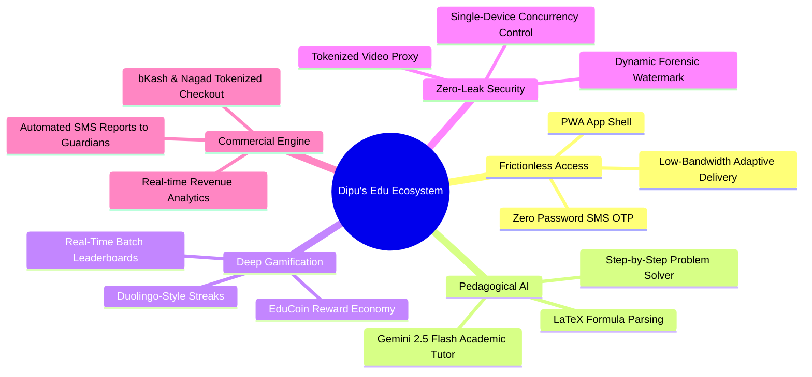
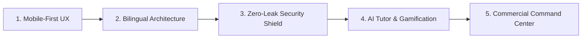
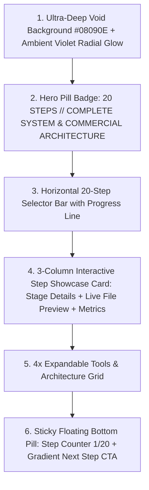
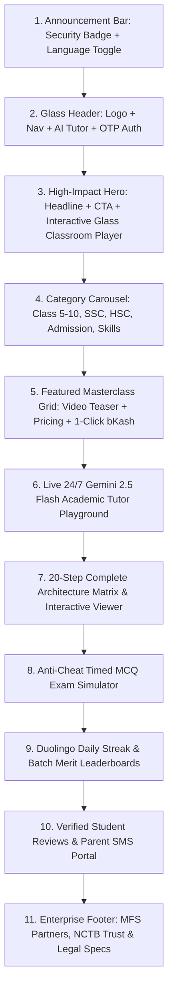
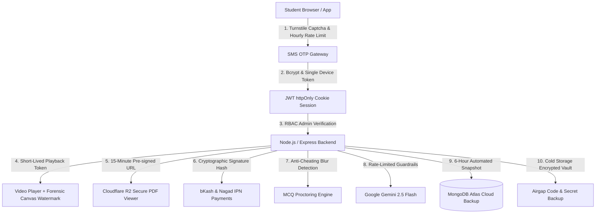

# Product Requirements Document (PRD)

## Project: Dipu's Edu — 20-Step Enterprise EdTech Architecture & Commercial Showcase
**Document Version:** 7.0.0 (Comprehensive English Specification)  
**Project Name:** Dipu's Edu  
**Live UI/UX Architecture Reference:** [https://dipusedo.vercel.app/](https://dipusedo.vercel.app/)  
**Target Market:** Bangladesh & Global Learners (Class 5 to HSC, Board Exam Prep, University Admission)  
**Language Support:** Bilingual (English + Bengali Native Interface)  
**Author:** Dipu & Principal Systems Engineering Architecture Team  
**Date:** September 2026  
**Status:** Approved / Specification Baseline  

---

## 1. Executive Summary & Vision

### 1.1 Executive Overview & Mission Statement
**Dipu's Edu** is a premier bilingual (Bengali & English) digital learning ecosystem engineered to democratize access to world-class academic education across Bangladesh (from NCTB Class 5 to HSC, Board Exam Candidates, and Competitive University Admissions including BUET, Medical, and Varsity Prep). 

By uniting the intuitive mobile-first consumer journeys of regional leaders (Shikho, 10 Minute School) with the deep cognitive engagement mechanics of Duolingo and cutting-edge GenAI tutoring (Google Gemini 2.5 Flash), Dipu's Edu eliminates academic friction, provides 24/7 personalized mentorship, and guarantees enterprise-grade digital asset protection.



### 1.2 Strategic Value Proposition & Target Market
| Parameter | Strategic Definition & Target Metrics |
| :--- | :--- |
| **Primary Audience** | Class 5 to HSC (Science, Commerce, Humanities), HSC Board Candidates, Varsity/Engineering/Medical Admission Seekers |
| **Bilingual Standard** | Native Bengali (বাংলা) interface & explanations with standard international English terminology |
| **Authentication Flow** | 100% Passwordless: 11-digit Bangladeshi mobile number + 6-digit SMS OTP (180s TTL) |
| **Target Infrastructure Cost** | < $0.005 per active student/month via Cloudflare R2 zero-egress video delivery & serverless caching |
| **Core AI Mentor** | Google Gemini 2.5 Flash with LaTeX math rendering and NCTB-aligned system prompt |
| **Monetization Engine** | Single-click bKash/Nagad Tokenized Checkout with dynamic coupon engine and bundle discounts |

---

### 1.3 The 5 Core Pillars of Architecture



#### 🏛️ Pillar 1: Frictionless Mobile-First Experience
* **Zero Password Friction:** Eliminates forgotten-password dropoffs by using 1-click 11-digit mobile number + fast 6-digit SMS OTP verification (powered by BulkSMSBD Gateway).
* **Network & Bandwidth Optimization:** PWA-ready responsive client engineered for 3G/4G rural mobile connections with aggressively cached assets and lightweight payload (< 150KB initial bundle).
* **Responsive Visual Hierarchy:** Deep dark celestial aesthetic (NEONE-inspired void `#030611` with luminous horizon arches) designed for comfortable extended late-night study sessions.

#### 🌐 Pillar 2: Bilingual Dual-Language Architecture
* **Seamless Language Toggling:** Real-time dynamic switching between Bengali (বাংলা) and English across all UI components, course syllabi, class notes, and exam portals.
* **Culturally Tailored Microcopy:** Educational terms standardized to familiar NCTB classroom terminology (e.g., "অধ্যায়", "মক টেস্ট", "লেকচার নোটস", "ডাউট ক্লিয়ারিং").
* **Bilingual AI Tutoring:** Google Gemini prompt architecture fine-tuned to accept mixed Banglish, English, or pure Bengali academic queries with accurate step-by-step bilingual breakdowns.

#### 🛡️ Pillar 3: 10-Tier Zero-Leak Bulletproof Security Shield
* **Dynamic Forensic Watermark:** Real-time HTML5 Canvas floating watermark permanently overlaying student phone number, student ID, and dynamic timestamp across video players and PDFs to deter screen recording.
* **Tokenized Video Streaming Proxy:** Direct Cloudflare R2 video storage URLs are never exposed to the client; all streams pass through authenticated, short-lived signed HMAC token streams.
* **Single-Device Concurrency Control (Tier 2):** Prevents credential and account sharing by strictly enforcing one active `sessionToken` per student ID with automatic previous device invalidation.
* **Proctored Examination Mode:** Tab-switching detection, clipboard locking, context menu disabling, and auto-submit on 3 violation flags during live mock exams.

#### 🧠 Pillar 4: Pedagogical AI & Behavioral Gamification
* **24/7 Gemini 2.5 Flash Study Mentor:** Real-time contextual academic assistant capable of parsing complex science & math questions, rendering LaTeX formulas, and generating practice quizzes.
* **Duolingo-Style Streak Engine:** Daily learning streak trackers (`🔥 ৭ দিন সক্রিয়`), milestone celebrations, and streak-freeze shields to build daily study habits.
* **EduCoin Virtual Economy:** Gamified reward tokens earned via quiz completion, watching full lectures, and top leaderboard rankings, redeemable for course discounts.
* **Real-time Batch Leaderboards:** Competitive cohort ranking across chapter tests and weekly model tests to drive healthy student peer motivation.

#### 💳 Pillar 5: Commercial Command Center & Guardian Connect
* **Automated MFS Payment Integration:** Native tokenized bKash & Nagad checkout APIs with instant course enrollment provisioning upon webhook HMAC verification.
* **Automated Guardian SMS Reporting:** Weekly SMS digests dispatched to parents detailing student attendance, watch time, quiz scores, and streak milestones.
* **Abandoned Cart Recovery Engine:** Automated SMS reminders with personalized 2-hour discount vouchers triggered when a student leaves checkout before completion.
* **Executive Administrative Dashboard:** Real-time cohort analytics, MRR/ARR tracking, instructor royalty payout calculators, and piracy threat logs.

---

## 2. Exact UI / UX Design System (Benchmarked from dipusedo.vercel.app)



### 2.1 Color Tokens & Atmosphere
- **Primary Background:** `#08090E` (Ultra-Deep Void Obsidian)
- **Ambient Top Radial Glow:** `w-[950px] h-[500px]` centered backdrop blur (`#A78BFA` & `#7C3AED` with `blur-[160px] opacity-15`)
- **Surface & Glass Cards:** `rgba(14, 17, 23, 0.96)` with `backdrop-filter: blur(24px)` and `border: 1px solid rgba(255, 255, 255, 0.08)`
- **Texture Overlays:** Micro dot grid pattern (`bg-dots` at 20% opacity) + subtle noise overlay (`noise-overlay`)
- **Dynamic Step Accent Themes:**
  - **Step 01 (PRD & Planning):** `#A78BFA` (`linear-gradient(135deg, #A78BFA, #7C3AED)`)
  - **Step 02 (UI/UX Design):** `#F472B6` (`linear-gradient(135deg, #F472B6, #DB2777)`)
  - **Step 03 (Coding Tools):** `#FBBF24` (`linear-gradient(135deg, #FBBF24, #F59E0B)`)
  - **Step 04 (AI Coding Assistant):** `#34D399` (`linear-gradient(135deg, #34D399, #059669)`)
  - **Step 05 (Backend Architecture):** `#22D3EE` (`linear-gradient(135deg, #22D3EE, #0891B2)`)
  - **Step 06 (Frontend Responsive):** `#FB923C` (`linear-gradient(135deg, #FB923C, #EA580C)`)
  - **Step 07 to Step 20:** Coordinated spectrum across Blue, Fuchsia, Rose, Indigo, and Emerald.

### 2.2 Typography
- **Primary Bengali Font:** `'Hind Siliguri'`, sans-serif (Weights: 400, 500, 600, 700, 900)
- **Primary Latin Font:** `'Inter'`, sans-serif (Weights: 400, 500, 600, 700, 800)
- **Monospace & Metrics:** `'JetBrains Mono'`, monospace

### 2.3 Layout Components
1. **Hero Section:**
   - Pill Badge: `<WorkflowIcon /> 20 STEPS // COMPLETE SYSTEM & COMMERCIAL ARCHITECTURE`
   - Main Headline: *"How I Build the Complete System"* with vivid gradient on *"Complete System"*.
   - Subtitle instructing user interaction across steps 01 to 20.
2. **Horizontal 20-Step Selector:**
   - Top slim progress line indicator.
   - Horizontally scrollable row containing 20 capsule pills (`01 PRD`, `02 UI/UX`, `03 Code`, `04 AI`, `05 Backend`, ..., `20 Gamification`).
   - Active state: Scaled `scale-105`, accented background glow (`#A78BFA20`), border outline.
3. **Interactive Step Showcase Card (3-Column Architecture):**
   - Header with category selector pills (e.g. `RESEARCH`, `SPEC WRITING`, `ROADMAP`, `AI SYNC`) + active pulsing green dot.
   - **Column 1 (Left):** Stage indicator `<STAGE 01>`, bold title, bilingual narrative summary, and gradient action button (`"View PRD Framework >"`).
   - **Column 2 (Center):** Glassmorphic preview card (e.g. `EdTech_PRD.md` with green `APPROVED` badge, simulated syntax lines, and glowing drop shadow).
   - **Column 3 (Right):** Primary metric counter (`10x`, `60 FPS`, `100% Type Safety`), descriptive subtext, and mode selector buttons (Gemini, Claude, Grok, GPT-4o).
4. **Tools & Architecture Grid:**
   - 4-card responsive grid showcasing underlying tools (Google Gemini, Claude AI, Grok, ChatGPT, VS Code, Node.js, MongoDB Atlas, etc.) with custom SVGs, gradient headers, bullet specifications, and expandable accordion drawers.
### 2.4 Commercial EdTech Homepage UI/UX Layout Specification
Benchmarked against modern EdTech SaaS designs and Pinterest visual references:



1. **Top Announcement & Trust Bar:** Shows live enrolled students count, 10-tier security status badge, and instant language toggle (বাংলা / English).
2. **Interactive Glass Classroom Player (Hero Visual):** Displays high-definition lecture teaser with dynamic rotating forensic canvas watermark (`017XXXXXXXX | ID: 9482`), theater controls, and live chat drawer.
3. **Category & Grade Switcher:** Fluid horizontal category pills with active gradient border and dynamic course filtering without page reload.
4. **Course Masterclass Showcase Cards:** Rich obsidian cards featuring course thumbnail, teacher credentials, lecture duration, discount badges (BDT 999 <s>1500</s>), and instant bKash/Nagad checkout modal.
5. **Gemini AI 2.5 Flash Academic Tutor Widget:** Interactive playground with sample NCTB questions, LaTeX math equation renderer, and daily quota tracker.
6. **20-Step Architectural Matrix:** Horizontal 20-capsule selector with 3-column detail view, live code preview, and metric counters.
7. **Exam Proctoring Sandbox:** Interactive MCQ test with 15-minute countdown, negative marking, and tab-switch warning toast.
8. **Duolingo-Inspired Gamification Panel:** Daily streak flame (🔥), EduCoins balance, freeze badges, and top 10 batch leaderboard.

---

## 3. The 10-Tier Bulletproof Security Suite



### Tier 1: 1-Hour 5-Send Rate Limit (SMS Pumping Defense)
- **Rule:** Any individual mobile number can trigger a maximum of **5 OTP requests within a rolling 60-minute window**.
- **Behavior:** The 6th request is rejected immediately with `HTTP 429 Too Many Requests` and a remaining cooldown timer.
- **Protection:** Invisible Cloudflare Turnstile CAPTCHA runs on the submission button to block botnets and automated SMS balance exhaustion attacks.

### Tier 2: Single-Device Concurrency Control (Account Sharing Prevention)
- **Problem:** Students frequently purchase one account and share login credentials with multiple classmates.
- **Solution:** Every successful OTP login writes a unique `activeSessionToken` (UUID v4) to the user's database record and signs it into an `httpOnly` JWT session cookie.
- **Enforcement:** If an account is logged in on a second device, the database generates a new session token. The first device's session token becomes invalid on the next API poll, triggering an instant security logout with the notice: *"Your account has been logged in from another device."*

### Tier 3: Dynamic Forensic Canvas Watermarking
- **Overlay:** An HTML5 `<canvas>` layer superimposed over the video container with `pointer-events: none`.
- **Forensic Content:** Renders the student's authenticated phone number and system ID (e.g. `01712345678 | ID: 9482`) at 20% opacity.
- **Randomized Motion:** Canvas recalculates coordinates and shifts the watermark across 8 screen quadrants every 4 seconds.
- **Result:** Any screen-recorded lecture video leaked onto YouTube, Telegram, or Facebook directly exposes the offending student's identity.

### Tier 4: Tokenized Video Streaming Proxy & Shortcut Interceptor
- **Masked URLs:** Raw Google Cloud Storage or Google Drive links are never exposed in client DOM or Network inspector tabs.
- **Proxy Token:** Streaming requests route through `/api/stream/token/:lessonId`, validating user enrollment before serving media chunks.
- **Keyboard & Mouse Blocker:** Right-click context menus are completely suppressed on player containers. Keyboard shortcuts `Ctrl+S`, `Ctrl+U`, `Ctrl+Shift+I`, and `F12` are blocked with security toasts.

### Tier 5: Cloudflare R2 Pre-Signed 15-Minute URLs & In-App Reader
- **Zero-Egress Storage:** Lecture sheets, revision booklets, and handnotes are hosted on private Cloudflare R2 buckets (zero bandwidth egress fees).
- **Short-Lived Signature:** Enrolled students receive AWS S3-compatible pre-signed URLs with an expiration lifetime of exactly 900 seconds (15 minutes).
- **View-Only Reader:** Rendered inside a customized in-app PDF.js reader with download, save, and print toolbar buttons stripped away.

### Tier 6: Payment Webhook Cryptographic Hash Verification
- **Integrity:** Automated callbacks from bKash Tokenized Checkout and Nagad APIs are validated against merchant SHA-256 HMAC signatures to prevent man-in-the-middle tampering.
- **Instant IPN:** Verifies transaction ID directly against the payment gateway before granting course access and dispatching congratulatory SMS alerts.

### Tier 7: Anti-Cheating Exam Proctoring Engine
- **Tab-Switch Detection:** The examination interface registers browser `visibilitychange` and `window.blur` events.
- **Strike Policy:** Switching tabs or opening external applications shows an immediate warning toast. On the 3rd infraction, the exam is forcibly auto-submitted.
- **Question Shuffling:** Questions and multiple-choice options are dynamically randomized per student session.

### Tier 8: Google Gemini AI Academic Guardrails & Daily Quotas
- **System Guardrails:** Gemini 2.5 Flash is strictly instructed to operate as a polite, step-by-step academic mentor for Bangladesh NCTB curriculum (Class 5–HSC). Non-academic queries or prompt injection attempts are rejected.
- **Rate-Limiting:** Free users are capped at 10 queries/day; enrolled paid users receive 35 queries/day. Quota usage is persisted in the MongoDB `ai_usage` collection.

### Tier 9: Dual-Vault Code Security & Automated Snapshots
- **GitFlow & Branch Protection:** Codebase is secured inside GitHub private repositories with mandatory pull request reviews and branch protection rules prohibiting direct commits to `main`.
- **Database Snapshots:** MongoDB Atlas automated daily and 6-hour point-in-time recovery snapshots prevent accidental data loss.

### Tier 10: Airgap Cold Storage & Modern TLS 1.3 Encryption
- **Environment Secrets:** Secrets (`.env`) are injected via cloud vault environments (never committed to version control).
- **Network Security:** Cloudflare DDoS mitigation, HTTP Strict Transport Security (HSTS), and TLS 1.3 encryption across all REST endpoints.

---

## 4. The 20-Step Architectural Matrix

Mirrored directly from the benchmark on [dipusedo.vercel.app](https://dipusedo.vercel.app/):

| Step | Module Title (EN / BN) | Core Technology & Implementation Details |
| :---: | :--- | :--- |
| **01** | **PRD & Planning**<br>*(PRD ও প্ল্যানিং)* | Product Requirements Document authored via Google Gemini & Claude; competitor benchmarking vs. 10 Minute School & Shikho; feature prioritization matrix. |
| **02** | **UI/UX Design**<br>*(UI/UX ডিজাইন)* | Obsidian dark palette (`#08090E`), ambient violet glow, Framer Motion spring physics, capsule tokens, mobile-first micro-interactions. |
| **03** | **Coding Tools**<br>*(কোডিং টুলস)* | TypeScript 5+ strict mode, Next.js 14 / Express.js, Tailwind CSS utility architecture, Node.js 20 LTS runtime. |
| **04** | **AI Coding Assistant**<br>*(AI কোডিং অ্যাসিস্ট্যান্ট)* | Intelligent pair programming with Google Gemini Code Assist, Claude 3.5 Sonnet, and automated unit test generation. |
| **05** | **Backend Architecture**<br>*(ব্যাকএন্ড আর্কিটেকচার)* | Express.js / Next.js API routes with PM2 process clustering, connection pooling, and MongoDB Atlas (M0/M10 clusters). |
| **06** | **Frontend Responsive UX**<br>*(ফ্রন্টএন্ড রেসপন্সিভ)* | Mobile-first app layout, sticky announcement bar, sticky glass navbar, theater mode classroom, Lighthouse 100 performance. |
| **07** | **Benchmark Adoption**<br>*(শিখো ও ১০ মিনিট স্কুল বেঞ্চমার্ক)* | Chapter-wise syllabus accordions, free demo video previews, instant mobile course checkout, and clean Bengali typography. |
| **08** | **NCTB AI Exam Engine**<br>*(পাঠ্যবই ভিত্তিক AI এক্সাম)* | Class 5 to HSC chapter-wise question banks, 15-minute countdown timer, negative marking (-0.25), and instant solution sheets. |
| **09** | **Team Collaboration & Git**<br>*(টিম কোলাবোরেশন ও গিট)* | GitHub private repositories, PR review workflows, semantic versioning, and CI/CD automated deployments. |
| **10** | **Phone OTP Login**<br>*(ফোন নম্বর OTP লগইন)* | Bangladeshi 11-digit phone auth, BulkSMSBD gateway adapter, 1-hour 5-send rate limit, 3-minute TTL, bcrypt hashed codes. |
| **11** | **24/7 AI Study Assistant**<br>*(২৪/৭ AI স্টাডি অ্যাসিস্ট্যান্ট)* | Gemini 2.5 Flash academic tutor, KaTeX LaTeX math rendering, daily student quota counters, Bengali & English explanations. |
| **12** | **SEO, Local SEO & AEO**<br>*(এসইও ও এআই সার্চ রেপুটেশন)* | Schema.org `Course` and `EducationalOrganization` JSON-LD markup, Google AI Overview optimization, high search visibility. |
| **13** | **Dual-Vault Code Security**<br>*(ডুয়াল-ভল্ট কোড সিকিউরিটি)* | GitHub private vaults, automated 6-hour database backups, and airgap off-site disaster recovery storage. |
| **14** | **Mobile PWA & Anti-Cheat**<br>*(মোবাইল অ্যাপ PWA ও অ্যান্টি-চিটিং)* | Installable Progressive Web App (manifest + service worker) for offline asset caching; tab-switch proctoring during exams. |
| **15** | **Piracy Shield & Parents Portal**<br>*(পাইরেসি শিল্ড ও প্যারেন্টস ড্যাশবোর্ড)* | Forensic dynamic canvas watermark with student phone & ID; monthly progress SMS dispatched to registered guardians. |
| **16** | **Gamification & Video Quality**<br>*(গ্যামিফিকেশন ও ভিডিও কোয়ালিটি)* | Multi-bitrate video stream player (360p to 1080p), EduCoin points economy, and unlockable achievement badges. |
| **17** | **CEO & Commercial Center**<br>*(সিইও ও বাণিজ্যিক নিয়ন্ত্রণ কেন্দ্র)* | Executive dashboard tracking Gross Revenue (BDT), Customer Acquisition Cost (CAC), and course completion drop-off funnels. |
| **18** | **bKash & Nagad 1-Click Checkout**<br>*(বিকাশ ও নগদ ১-ক্লিক পেমেন্ট)* | Tokenized payment gateway integration, instant IPN webhook auto-enrollment, congratulatory SMS, and promo coupon engine. |
| **19** | **AI Photo & Voice Doubt Solver**<br>*(এআই ফটো/ভয়েস ডাউট সলভার)* | Photo OCR question scanning, speech-to-text question input, and chapter-wise community discussion threads with verified teacher answers. |
| **20** | **Duolingo Streak & Leaderboards**<br>*(ডুওলিঙ্গো স্ট্রিক ও লাইভ লিডারবোর্ড)* | Daily learning streak counter (🔥), freeze tokens, and batch-wide real-time merit list leaderboards. |

---

## 5. MongoDB Database Schemas (English Specification)

### 5.1 Users Collection (`users`)
```json
{
  "_id": "ObjectId",
  "phone": "01712345678",
  "name": "Tanvir Hasan",
  "role": "student", // "student" | "instructor" | "admin"
  "institution": "Dhaka Residential Model College",
  "classLevel": "HSC", // "Class-5" ... "Class-10", "SSC", "HSC"
  "guardianPhone": "01812345678",
  "enrolledCourses": ["ObjectId(courseId_1)"],
  "activeSessionToken": "uuid-v4-session-token",
  "streakDays": 7,
  "eduCoins": 250,
  "preferredLanguage": "bn", // "bn" | "en"
  "createdAt": "ISODate"
}
```

### 5.2 OTP Records Collection (`otps`)
```json
{
  "_id": "ObjectId",
  "phone": "01712345678",
  "otpHash": "$2b$10$hashedOtpString...",
  "attempts": 0,
  "hourlyRequestCount": 2,
  "lastRequestAt": "ISODate",
  "expireAt": "ISODate" // TTL index: expires in 180 seconds
}
```

### 5.3 Courses Collection (`courses`)
```json
{
  "_id": "ObjectId",
  "slug": "hsc-physics-1st-paper",
  "title": { "en": "HSC Physics 1st Paper Masterclass", "bn": "HSC পদার্থবিজ্ঞান ১ম পত্র - স্পেশাল মাস্টার ব্যাচ" },
  "classLevel": "HSC",
  "category": "hsc",
  "instructor": "Dipu Sir",
  "price": 1500,
  "discountPrice": 999,
  "thumbnail": "https://materials.dipusedu.com/thumbnails/physics.jpg",
  "isPublished": true,
  "chapters": [
    {
      "id": "ch_vectors",
      "title": { "en": "Chapter 2: Vectors", "bn": "অধ্যায় ২: ভেক্টর" },
      "order": 1,
      "lessons": [
        {
          "id": "les_vec_1",
          "title": { "en": "Lecture 1: Vector Fundamentals & Addition", "bn": "লেকচার ১: ভেক্টরের প্রকারভেদ ও যোগ-বিয়োগ" },
          "videoType": "youtube", // "youtube" | "protected_gdrive"
          "videoSource": "vY0q49dM79w",
          "isFree": true,
          "duration": "45 min",
          "pdfAttachment": {
            "title": "Vector Lecture Handnote.pdf",
            "r2Key": "notes/hsc/physics/vector-handnote.pdf"
          }
        }
      ]
    }
  ]
}
```

### 5.4 MCQ Exams Collection (`exams`)
```json
{
  "_id": "ObjectId",
  "title": { "en": "Vector Model Test 01", "bn": "ভেক্টর মডেল টেস্ট - ০১" },
  "courseId": "ObjectId(courseId)",
  "durationMinutes": 15,
  "negativeMarkPerWrong": 0.25,
  "totalMarks": 20,
  "questions": [
    {
      "id": 1,
      "question": "What is the angle between two equal vectors if their resultant equals one of them?",
      "options": ["0 degrees", "60 degrees", "120 degrees", "180 degrees"],
      "correctIndex": 2,
      "explanation": "Since P = Q and R = P, by R^2 = P^2 + Q^2 + 2PQ cos(alpha), cos(alpha) = -1/2 -> alpha = 120 deg."
    }
  ]
}
```

### 5.5 AI Quota Tracking (`ai_usage`)
```json
{
  "_id": "ObjectId",
  "userId": "ObjectId(userId)",
  "date": "2026-09-24", // YYYY-MM-DD
  "promptCount": 12,
  "dailyLimit": 35, // 10 for free, 35 for enrolled
  "lastQueryAt": "ISODate"
}
```

---

## 6. Project Roadmap & Delivery Milestones

- **Milestone 1:** Architecture Baseline & Specification (Approved PRD v7.0 & PROMPTS v7.0).
- **Milestone 2:** Backend API Services (Express, MongoDB Models, SMS Gateway Adapter with 1-hr 5-OTP limiter).
- **Milestone 3:** Frontend Exact Replication (Obsidian dark theme, 20-step horizontal selector, 3-column step cards, sticky bottom pill bar).
- **Milestone 4:** Media & Security Integration (YouTube free demo player, protected Google Cloud player with dynamic canvas watermark, Cloudflare R2 pre-signed PDF reader).
- **Milestone 5:** AI Study Mentor & Examination System (Gemini 2.5 Flash, KaTeX equations, timed MCQ exam with proctoring).
- **Milestone 6:** Payment Webhook & Production Deployment (bKash/Nagad checkout, Vercel/Render hosting, custom domain SSL).
