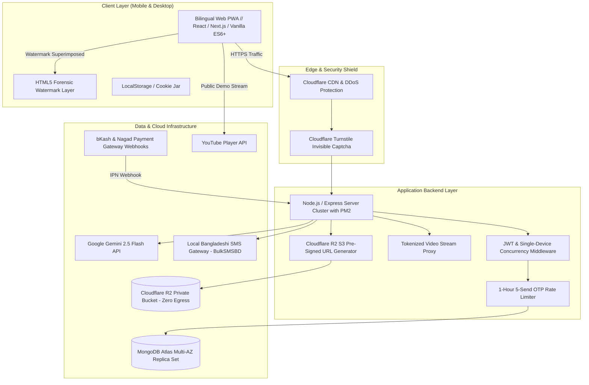

# System Architecture & Technical Topology — Dipu's Edu

## 1. System Topology Overview

---

## 2. Technical Stack Details

| Domain | Selected Technology | Technical Rationale |
| :--- | :--- | :--- |
| **Frontend Framework** | Semantic HTML5, Vanilla Modern CSS / Tailwind, ES6+ JS | Zero bloated bundle dependencies; loads in < 1 second on low-bandwidth 3G/4G connections. |
| **Bilingual Localization** | Custom JSON dictionary (`en`, `bn`) with state toggle | Instant zero-reload language switching between Bengali and English across all UI labels and metadata. |
| **Backend Runtime** | Node.js 20 LTS + Express.js | High-concurrency non-blocking I/O capable of handling 5,000+ simultaneous students taking timed exams. |
| **Cloud Database** | MongoDB Atlas (M0 Free -> M10 Production) | Flexible document schema supporting nested chapters, lessons, questions, and arrays of enrolled courses. |
| **Object Storage** | Cloudflare R2 (S3 Client API) | **Zero bandwidth egress charges**; eliminates high cloud transfer bills when serving large PDF handnotes. |
| **AI Academic Engine** | Google Gemini 2.5 Flash API | Sub-second response latency for bilingual academic tutoring and LaTeX mathematical derivations. |
| **SMS Gateway Adapter** | BulkSMSBD / Greenweb / Elitbuzz API | Direct telco routing ensuring OTP delivery within 5–8 seconds across Grameenphone, Banglalink, Robi, and Teletalk. |
| **Payment Gateway** | bKash Tokenized Checkout + Nagad API | Bangladesh's most popular MFS channels with automated Instant Payment Notification (IPN) webhooks. |

---

## 3. The 10-Tier Security Suite Architecture

1. **SMS Pumping Shield (1-Hour 5-Send Rate Limit):** Tracks OTP timestamps per mobile number in a sliding 60-minute window; returns `HTTP 429` on 6th request with cooldown countdown.
2. **Single-Device Concurrency Control:** Writes a new `activeSessionToken` (UUID) upon every successful login, invalidating existing sessions on older devices upon next poll.
3. **Dynamic Forensic Canvas Watermark:** Superimposes student phone and ID at 20% opacity on an HTML5 canvas overlay layer; shifts coordinates every 4 seconds across 8 screen zones.
4. **Tokenized Video Stream Proxy:** Masks raw storage links behind `/api/stream/token/:lessonId`; suppresses right-click, `F12`, `Ctrl+U`, and `Ctrl+S`.
5. **Cloudflare R2 15-Minute Pre-Signed URLs:** S3 SDK generates short-lived signed URLs for enrolled students, viewed inside a download-disabled reader.
6. **Payment Webhook Cryptographic Verification:** Validates merchant SHA-256 HMAC hash on IPN callbacks before granting course access.
7. **Anti-Cheating Exam Proctoring:** Monitors `visibilitychange` and `window.blur` events during timed MCQ exams, enforcing auto-submit on 3 violations.
8. **Gemini AI Academic Guardrails & Daily Quotas:** Strict system instructions limited to NCTB syllabus; enforces 10/day (free) and 35/day (enrolled) query limits.
9. **Dual-Vault Code Security & Automated Snapshots:** GitHub private repositories with branch protection + MongoDB Atlas 6-hour snapshot backups.
10. **Airgap Cold Storage & TLS 1.3:** Off-site cold code storage and modern HTTPS transport encryption.
