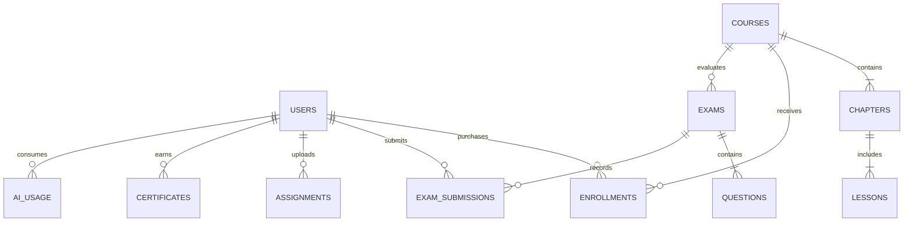

# Database Schema & Data Dictionary — Dipu's Edu

> [!NOTE]
> **Schema Versioning Note:** This document defines the core domain models. For the full production and admin panel schema (including 11 additional collections such as `categories`, `certificates`, `teachers`, `class_notes`, etc.), please refer to [`database-schema-v2.md`](file:///c:/Users/User/Documents/dipu%20s%20po/docs/database-schema-v2.md).

## 1. Entity Relationship (ER) Diagram



---

## 2. Collection Specifications

### 2.1 Users Collection (`users`)
Stores student, instructor, and super-admin credentials, session tokens, and gamification state.

| Field | Type | Index | Constraints & Description |
| :--- | :--- | :---: | :--- |
| `_id` | ObjectId | PK | Unique document identifier. |
| `phone` | String | Unique | 11-digit Bangladeshi mobile number (`/^01[3-9]\d{8}$/`). |
| `name` | String | - | Student or administrator display name. |
| `role` | String | Yes | Enum: `'student'`, `'instructor'`, `'admin'`. Default: `'student'`. |
| `institution`| String | - | School / College name (e.g. "DRMC"). |
| `classLevel` | String | Yes | Enum: `'Class-5'` ... `'Class-10'`, `'SSC'`, `'HSC'`, `'All'`. |
| `guardianPhone` | String | - | Parent's phone number for monthly progress SMS broadcasts. |
| `enrolledCourses` | Array[ObjectId] | - | Array of Course references. |
| `activeSessionToken` | String | Yes | UUID v4 string verifying single-device concurrency. |
| `streakDays` | Number | - | Current continuous daily learning streak (🔥). Default: `0`. |
| `lastActiveDate` | Date | - | Date timestamp of last completed activity. |
| `eduCoins` | Number | - | Virtual rewards balance. Default: `50`. |
| `preferredLanguage` | String | - | Enum: `'bn'`, `'en'`. Default: `'bn'`. |
| `isActive` | Boolean | - | Account active status. Default: `true`. |
| `createdAt` | Date | - | Account creation timestamp. |

---

### 2.2 OTP Collection (`otps`)
Stores ephemeral one-time passwords for mobile verification with automated TTL expiration.

| Field | Type | Index | Constraints & Description |
| :--- | :--- | :---: | :--- |
| `_id` | ObjectId | PK | Unique document identifier. |
| `phone` | String | Yes | 11-digit mobile number. |
| `otpHash` | String | - | Bcrypt hashed 6-digit OTP code (salt rounds: 10). |
| `attempts` | Number | - | Number of incorrect verification attempts. Max: `3`. |
| `createdAt` | Date | - | Creation timestamp. |
| `expireAt` | Date | TTL | **TTL index (180 seconds).** MongoDB automatically drops document. |

---

### 2.3 Courses Collection (`courses`)
Stores course syllabi, pricing, video providers, and Cloudflare R2 PDF attachments.

| Field | Type | Index | Constraints & Description |
| :--- | :--- | :---: | :--- |
| `_id` | ObjectId | PK | Unique course identifier. |
| `slug` | String | Unique | URL-safe course identifier (e.g. `'hsc-physics-1st-paper'`). |
| `title` | Object | - | Bilingual title: `{ en: String, bn: String }`. |
| `classLevel` | String | Yes | Target grade (`'Class-5'` to `'HSC'`). |
| `category` | String | Yes | Category tag (`'hsc'`, `'ssc'`, `'class-9-10'`, `'class-5-8'`). |
| `instructor` | String | - | Lead teacher name (e.g. "Dipu Sir"). |
| `price` | Number | - | Regular tuition fee in BDT (e.g. `1500`). |
| `discountPrice` | Number | - | Active promotional fee in BDT (e.g. `999`). |
| `thumbnail` | String | - | Cloudflare R2 / CDN image URL. |
| `isPublished` | Boolean | Yes | Publication visibility status. Default: `true`. |
| `chapters` | Array[Object]| - | Array of Chapter documents containing nested Lessons. |

#### Nested Chapter & Lesson Schema:
```json
{
  "chapterTitle": { "en": "Chapter 2: Vectors", "bn": "অধ্যায় ২: ভেক্টর" },
  "order": 1,
  "lessons": [
    {
      "lessonTitle": { "en": "Lecture 1: Vector Fundamentals", "bn": "লেকচার ১: ভেক্টর মৌলিক আলোচনা" },
      "videoType": "youtube", // "youtube" | "protected_gdrive"
      "videoSource": "vY0q49dM79w", // YouTube ID or Encrypted Storage File ID
      "isFree": true,
      "durationMinutes": 45,
      "pdfAttachment": {
        "title": "Vector Handnote.pdf",
        "r2Key": "notes/hsc/physics/vector-handnote.pdf",
        "allowDownload": false
      }
    }
  ]
}
```

---

### 2.4 Exams Collection (`exams`)
Stores chapter mock tests, question banks, countdown durations, and negative marking rules.

| Field | Type | Index | Constraints & Description |
| :--- | :--- | :---: | :--- |
| `_id` | ObjectId | PK | Unique exam identifier. |
| `courseId` | ObjectId | Yes | Reference to parent Course. |
| `title` | Object | - | Bilingual title: `{ en: String, bn: String }`. |
| `durationMinutes` | Number | - | Timer countdown in minutes (e.g. `15`). |
| `passMarks` | Number | - | Minimum passing threshold. |
| `negativeMarkPerWrong` | Number | - | Penalty subtracted per wrong answer (default: `0.25`). |
| `questions` | Array[Object]| - | Array of MCQ question objects. |

#### Question Object Schema:
```json
{
  "id": 1,
  "question": "What is the angle between two equal vectors when resultant equals one?",
  "options": ["0°", "60°", "120°", "180°"],
  "correctIndex": 2,
  "explanation": "Since P = Q = R, cos(alpha) = -1/2 which gives alpha = 120 degrees."
}
```

---

### 2.5 Enrollments & Payments Collection (`enrollments`)
Stores verified student purchase transactions and audit receipts.

| Field | Type | Index | Constraints & Description |
| :--- | :--- | :---: | :--- |
| `_id` | ObjectId | PK | Unique enrollment record. |
| `userId` | ObjectId | Yes | Reference to enrolled User. |
| `courseId` | ObjectId | Yes | Reference to purchased Course. |
| `amount` | Number | - | Final paid amount in BDT after discounts. |
| `paymentMethod` | String | - | Enum: `'bKash'`, `'Nagad'`, `'Manual'`. |
| `trxID` | String | Unique | Payment gateway transaction identifier. |
| `couponCode` | String | - | Applied promo code if used (e.g. `'DIPU20'`). |
| `status` | String | Yes | Enum: `'completed'`, `'pending'`, `'failed'`. |
| `enrolledAt` | Date | - | Successful transaction timestamp. |

---

### 2.6 AI Usage Collection (`ai_usage`)
Tracks daily query volume per student for Google Gemini quota enforcement.

| Field | Type | Index | Constraints & Description |
| :--- | :--- | :---: | :--- |
| `_id` | ObjectId | PK | Unique record identifier. |
| `userId` | ObjectId | Compound | Reference to User. |
| `date` | String | Compound | Date string in format `YYYY-MM-DD`. |
| `promptCount` | Number | - | Number of queries asked on this date. |
| `dailyLimit` | Number | - | Allowed quota (10 for free students, 35 for enrolled). |
| `lastQueryAt` | Date | - | Timestamp of last submitted question. |

*Compound Index:* `{ userId: 1, date: 1 }` (Unique).
