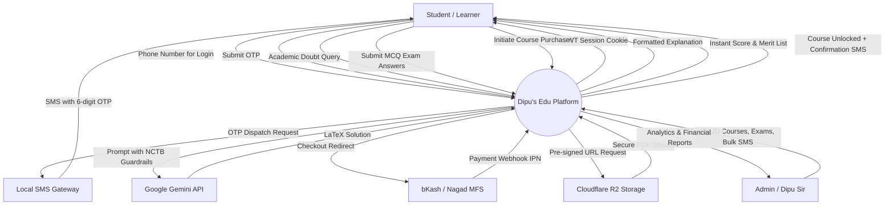
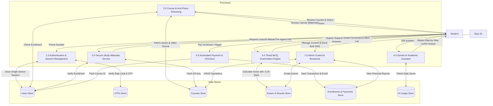
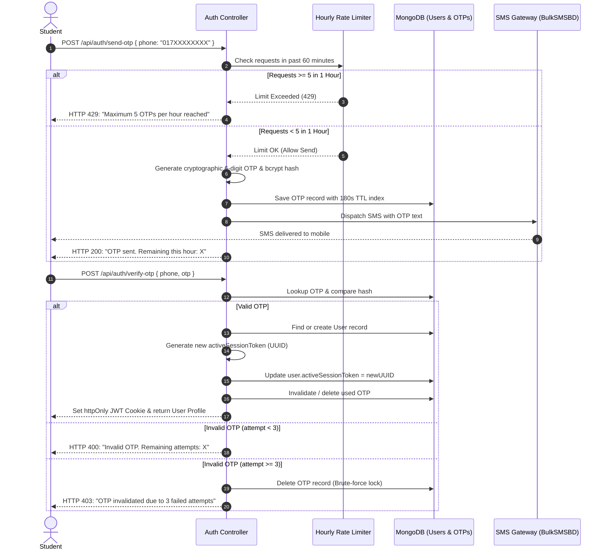
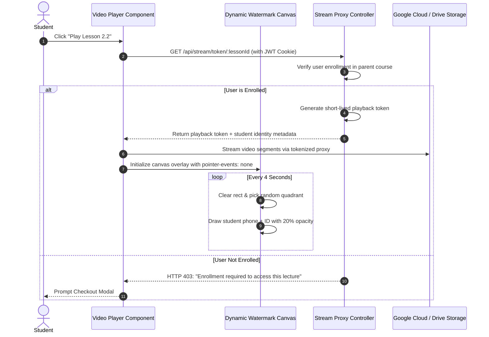

# Data Flow Diagrams (DFD) — Dipu's Edu

## 1. Level 0: Context Diagram

---

## 2. Level 1: Sub-Processes Data Flow Diagram

---

## 3. Level 2: Detailed Process Workflows

### 3.1 Process 1.0: Phone OTP Authentication Workflow

### 3.2 Process 2.0: Anti-Piracy Video Playback & Watermarking Workflow

